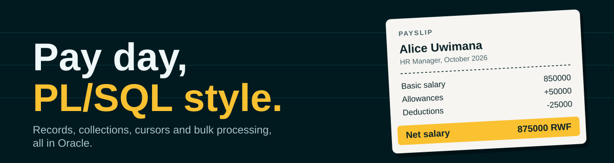
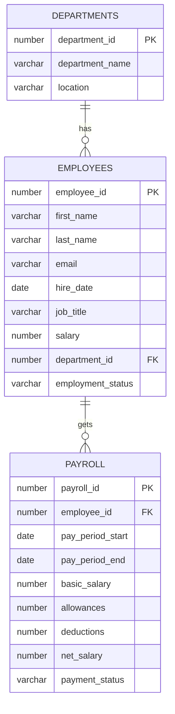
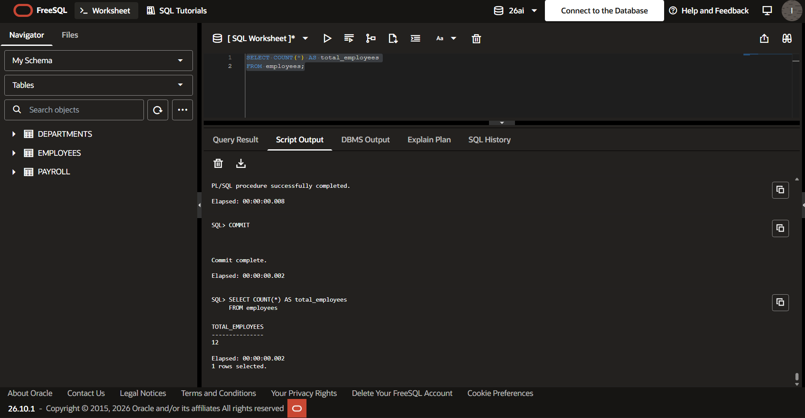
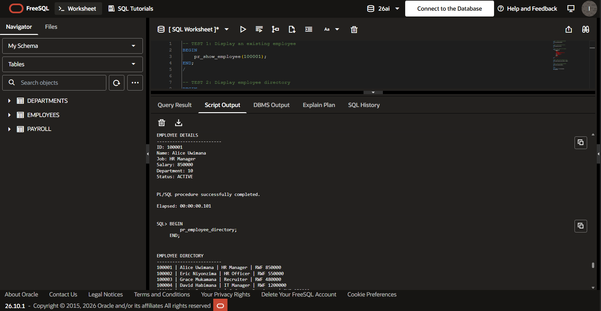
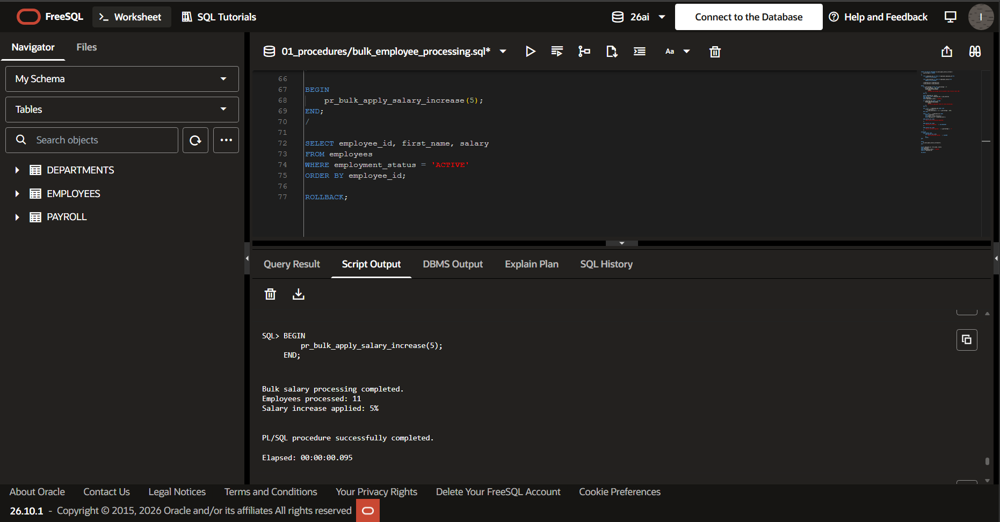
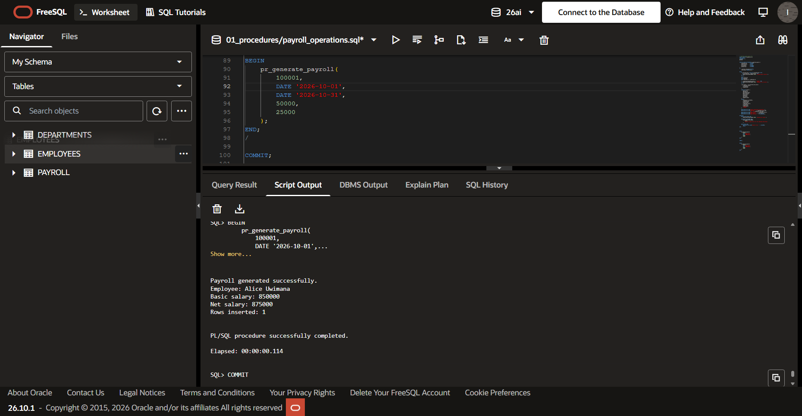
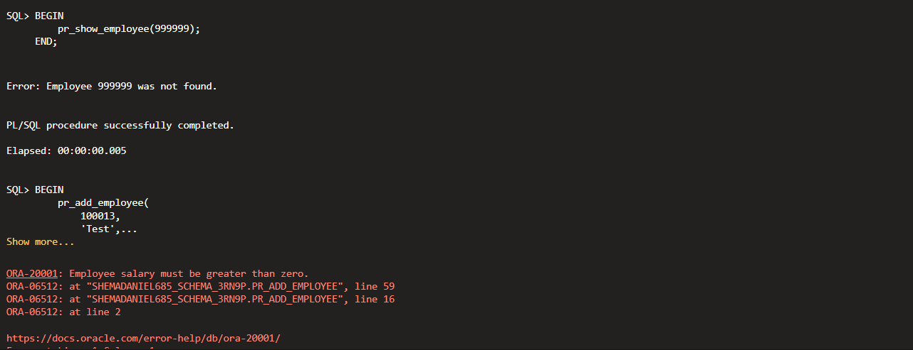
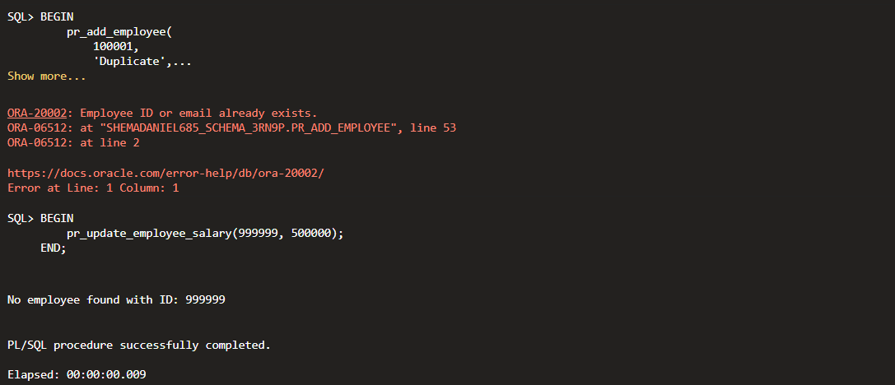
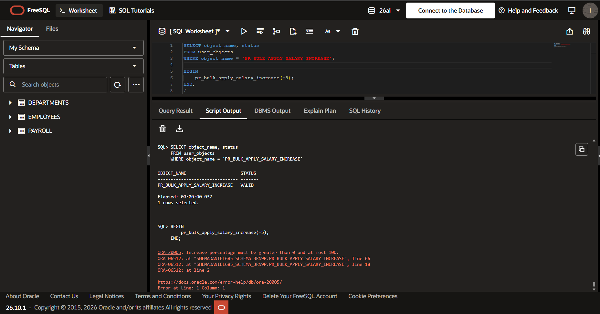
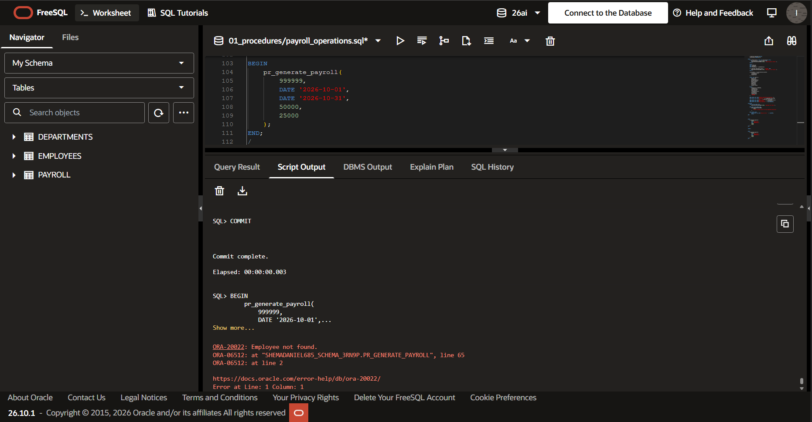

<p align="center">
  
</p>

# Employee Management and Payroll System

Twelve people in four departments are waiting for pay day, and Oracle PL/SQL does the math so nobody gets paid in cookies.

| What | Details |
|---|---|
| Course | INSY 8311, Database Development with PL/SQL |
| Assignment | Group Assignment IV: Records, Collections, Cursors and Bulk Processing |
| Class group | B (Tuesday) |
| Student 1 | Ishimwe Semuhungu Daniel, 20251SEN037 |
| Student 2 | Kacyeye Igihozo Jane, 20251SEN127 |
| Database | Oracle FreeSQL |

**Jump to:** [The story](#the-story) | [What is inside](#what-is-inside) | [Run it](#run-it) | [Proof](#proof-it-really-ran) | [When things go wrong](#when-things-go-wrong) | [The speed race](#the-speed-race) | [Honest notes](#ai-use-and-teamwork)

## The story

Picture a small company. It has 4 departments and 12 employees. Each month, someone must work out who gets paid what. Doing that by hand is how mistakes sneak in.

So we gave the job to Oracle. Our code can:

- Show one employee, or the whole staff list.
- Hire someone, change a salary, or remove an employee.
- Give every active employee a raise in one shot.
- Hire a whole batch, and tell us which rows were bad without stopping the rest.
- Make a payroll row with the right take-home pay.
- Race slow code against fast code, with a stopwatch.

The code has 10 procedures and 2 functions. The sample data has 12 employees in 4 departments.

## What is inside

Three tables hold the story. A fourth, tiny table is only a stopwatch track for the speed race.



Rules in the tables stop bad data at the door: salaries must be above zero, status is `ACTIVE` or `INACTIVE`, net pay must equal basic plus allowances minus deductions, and one employee gets one payroll row per pay period.

### Where each assignment idea lives

| Idea from the assignment | What we did | Where to look |
|---|---|---|
| Records | `%ROWTYPE` boxes shaped like a table row, plus our own record type | [pr_show_employee](01_procedures/pr_show_employee.sql), [pr_generate_payroll](01_procedures/pr_generate_payroll.sql), [pr_employee_directory](01_procedures/pr_employee_directory.sql) |
| Collections | Associative arrays, including one that holds whole records | [pr_bulk_apply_salary_increase](01_procedures/pr_bulk_apply_salary_increase.sql), [pr_bulk_onboard_new_hires](01_procedures/pr_bulk_onboard_new_hires.sql) |
| Implicit cursors | `SQL%ROWCOUNT` on insert, `SQL%NOTFOUND` on update, `SQL%FOUND` on delete | [pr_add_employee](01_procedures/pr_add_employee.sql), [pr_update_employee_salary](01_procedures/pr_update_employee_salary.sql), [pr_delete_employee](01_procedures/pr_delete_employee.sql) |
| Explicit cursors | `OPEN`, `FETCH`, `CLOSE` | [pr_employee_directory](01_procedures/pr_employee_directory.sql) |
| Bulk processing | `BULK COLLECT`, `FORALL`, and `SAVE EXCEPTIONS` for bad rows | [pr_bulk_apply_salary_increase](01_procedures/pr_bulk_apply_salary_increase.sql), [pr_bulk_onboard_new_hires](01_procedures/pr_bulk_onboard_new_hires.sql), [pr_compare_bulk_vs_loop](01_procedures/pr_compare_bulk_vs_loop.sql) |
| Procedures | 10, with `IN` and `OUT` parameters | [01_procedures](01_procedures) |
| Functions | 2, called from SQL and from a block | [fn_calculate_net_salary](02_functions/fn_calculate_net_salary.sql), [fn_department_salary_total](02_functions/fn_department_salary_total.sql) |
| Exceptions | `NO_DATA_FOUND`, `TOO_MANY_ROWS`, `DUP_VAL_ON_INDEX`, our own named exceptions, and `RAISE_APPLICATION_ERROR` | every procedure and function, see [the error table](#when-things-go-wrong) |

The long version, with the reasons behind each choice, is in [docs/IMPLEMENTATION_NOTES.md](docs/IMPLEMENTATION_NOTES.md).

### Folder map

```text
plsql-assignment4-20251SEN037-20251SEN127/
├── README.md
├── .gitignore
├── 00_schema/
│   ├── 01_create_tables.sql
│   └── 02_insert_sample_data.sql
├── 01_procedures/
│   ├── pr_show_employee.sql
│   ├── pr_employee_directory.sql
│   ├── pr_add_employee.sql
│   ├── pr_update_employee_salary.sql
│   ├── pr_delete_employee.sql
│   ├── pr_test_multiple_employee_lookup.sql
│   ├── pr_bulk_apply_salary_increase.sql
│   ├── pr_bulk_onboard_new_hires.sql
│   ├── pr_compare_bulk_vs_loop.sql
│   └── pr_generate_payroll.sql
├── 02_functions/
│   ├── fn_calculate_net_salary.sql
│   └── fn_department_salary_total.sql
├── 03_tests/
│   ├── test_success_cases.sql
│   └── test_error_cases.sql
├── screenshots/
└── docs/
    ├── IMPLEMENTATION_NOTES.md
    └── banner.svg
```

## Run it

Open Oracle FreeSQL and run these files in this order. Run each file as a script.

1. `00_schema/01_create_tables.sql` builds the tables, the payroll counter and the stopwatch table.
2. `00_schema/02_insert_sample_data.sql` adds 4 departments and 12 employees.
3. `02_functions/fn_calculate_net_salary.sql` and `02_functions/fn_department_salary_total.sql`. Functions go first because `pr_generate_payroll` calls one.
4. Every file in `01_procedures/`, in any order.
5. `03_tests/test_success_cases.sql` should finish with no red errors.
6. `03_tests/test_error_cases.sql` should show many red errors. That is the point. Each one is a bad request that our code caught on purpose.

To start fresh, run this and then begin again at step 1:

```sql
DROP TABLE bulk_perf_test PURGE;
DROP TABLE payroll PURGE;
DROP TABLE employees PURGE;
DROP TABLE departments PURGE;
DROP SEQUENCE seq_payroll_id;
```

## Proof it really ran

These are real screenshots from Oracle FreeSQL.

### The good days

The sample data is in. Twelve employees, as promised.



One employee on screen from a `%ROWTYPE` record, then the full directory from an explicit cursor.



A 5 percent raise for every active employee, done with `BULK COLLECT` and `FORALL`. Eleven people were paid more. The twelfth is inactive, so she was skipped.



Payroll for Alice, October 2026. Basic 850000, plus 50000, minus 25000, gives 875000.



### The bad days

A missing employee gets a friendly message. A negative salary gets `ORA-20001`.



A repeated employee ID gets `ORA-20002`. Updating a person who is not there prints a note and carries on.



A raise of minus 5 percent gets `ORA-20005`. The procedure says VALID first, so we know the error is ours and not a compile problem.



Payroll for employee 999999 gets `ORA-20022`.



## When things go wrong

Every error we raise has its own number, so you can tell what happened at a glance. All of them are triggered in [test_error_cases.sql](03_tests/test_error_cases.sql), except `ORA-20006`, which needs every employee to be inactive.

| Code | What went wrong | Raised by |
|---|---|---|
| `ORA-20001` | New employee has a salary of zero or less | `pr_add_employee` |
| `ORA-20002` | Employee ID or email is already taken | `pr_add_employee` |
| `ORA-20003` | New salary is zero or less | `pr_update_employee_salary` |
| `ORA-20004` | Employee still has payroll rows, so they cannot be deleted | `pr_delete_employee` |
| `ORA-20005` | Raise percentage is not between 0 and 100 | `pr_bulk_apply_salary_increase` |
| `ORA-20006` | No active employees to give a raise to | `pr_bulk_apply_salary_increase` |
| `ORA-20007` | Department does not exist | `pr_add_employee` |
| `ORA-20010` to `ORA-20013` | Bad basic salary, allowances or deductions, or deductions bigger than pay | `fn_calculate_net_salary` |
| `ORA-20020` | Pay period ends before it starts | `pr_generate_payroll` |
| `ORA-20021` | Employee is inactive | `pr_generate_payroll` |
| `ORA-20022` | Employee does not exist | `pr_generate_payroll` |
| `ORA-20023` | Payroll for this person and period already exists | `pr_generate_payroll` |
| `ORA-20030` and `ORA-20031` | Department does not exist, or was left empty | `fn_department_salary_total` |
| `ORA-20040` | Speed race row count is outside 1 to 100000 | `pr_compare_bulk_vs_loop` |

Bad rows inside a bulk insert are different. They do not stop the whole batch. `pr_bulk_onboard_new_hires` keeps going, then lists each failed row and sends the counts back through its `OUT` parameters.

## The speed race

Sending 20000 inserts one at a time is like walking to the shop once for every apple. `FORALL` is one trip with a big bag. [pr_compare_bulk_vs_loop](01_procedures/pr_compare_bulk_vs_loop.sql) runs both with a stopwatch and prints the times. It cleans up after itself, so no rows are left behind.

Run `BEGIN pr_compare_bulk_vs_loop(20000); END;` and see how big the gap is on your own machine. The full explanation is in the [implementation notes](docs/IMPLEMENTATION_NOTES.md#bulk-processing-and-speed).

## AI use and teamwork

**AI help, in plain words. ** ChatGPT guided us planning the project efficiently and write the first version of the SQL, the tests and the notes. Claude helped us check our code against the assignment brief and find where correction is needed. We ran the scripts in Oracle Free SQL, took the screenshots that came from those runs, and fixed the necessary bugs. Both of us can explain every file, because we are the ones who have to.

**Teamwork.** Both of us commit to this repository, review each other's code and answer questions on any file. Daniel is the integration lead.
